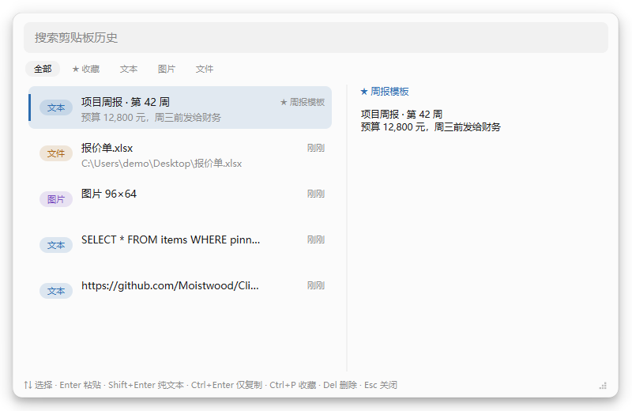
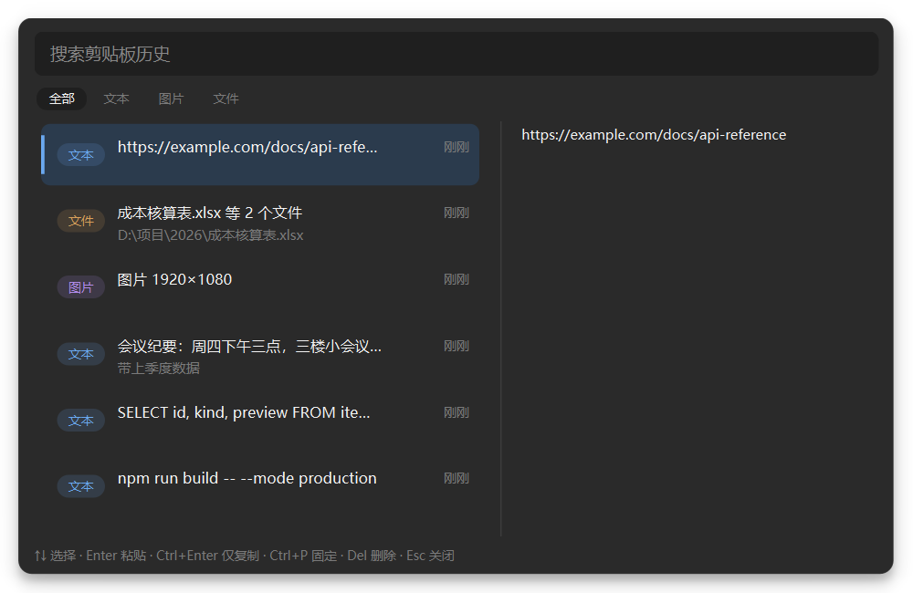

# ClipNest

一个只在你本机运行的 Windows 剪贴板历史工具。按一次热键，最近复制过的文字、图片、文件全在里面，选中就能粘回去。

**不联网。不上传。不注册账号。** 数据只写在你自己的 `%APPDATA%\ClipNest` 目录里。

| 浅色 | 深色 |
|---|---|
|  |  |

## 它做什么

- 后台记录你复制的**文本、图片、文件路径**，不打断任何操作
- 从浏览器、Word 复制的文字会连同 HTML / RTF 一起保存，粘贴时还原原来的格式；按 `Shift+Enter` 则只粘纯文本，不带任何样式
- 全局热键 `Ctrl+Alt+V` 呼出居中面板，键盘上下选、回车即粘贴
- 支持搜索，中文可直接搜：三个字以上走 FTS5 trigram 索引，两个字自动降级成模糊匹配；老版本 SQLite 没有 trigram 时整体降级，功能不受影响
- 重复内容自动去重并置顶
- 重要的内容按 `Ctrl+P` 收进「★ 收藏」：不会过期、不会被清理，点筛选栏的「★ 收藏」单独查看
- 右键条目可以写备注 / 起名字，备注也能被搜索框搜到；还可以只粘纯文本、打开文件所在位置
- 密码管理器标记为「不要记录」的内容会被自动跳过
- 托盘常驻，可随时暂停监听
- 设置面板里能改热键、条数上限、保留天数，改完立即生效
- 使用统计：记录条数、占用空间、类型占比、最常复制的程序
- 历史记录可以导出成 JSON，换机器后再导入回来；收藏夹也能单独导出，图片一并打包

## 快捷键

| 操作 | 按键 |
|---|---|
| 呼出面板 | `Ctrl+Alt+V` |
| 选择 | `↑` `↓` 或直接点击 |
| 粘贴（保留原格式） | `Enter` |
| 粘贴为纯文本 | `Shift+Enter` |
| 只复制不粘贴 | `Ctrl+Enter` |
| 直接粘贴第 N 条 | `Ctrl+1` ~ `Ctrl+9` |
| 加入 / 移出收藏 | `Ctrl+P` |
| 条目更多操作 | 鼠标右键 |
| 删除当前条目 | `Delete` |
| 关闭面板 | `Esc` |

## 和系统自带的 Win+V 是什么关系

Windows 10 1809 之后系统就自带剪贴板历史，按 `Win+V` 呼出。它默认是关的，要先到「设置 → 系统 → 剪贴板」里手动打开，微软也不主动提示，所以很多人并不知道它存在。按微软官方文档，它有这么几条边界：

| | Win+V | ClipNest |
|---|---|---|
| 历史条数 | 25 条，超出后自动丢最旧的 | 默认 500 条，可调 |
| 重启之后 | 全部清空，只有手动固定的能留下 | 保留，默认 7 天 |
| 单条上限 | 4 MB，超过就不进历史 | 无此限制 |
| 搜索 | 不支持，只能上下翻 | 全文搜索，中文可用 |
| 类型筛选 | 无 | 文本 / 图片 / 文件 |
| 文件路径 | 不记录 | 记录并可预览 |
| 跨设备同步 | 开启后会把复制的文本加密上传到微软服务器 | 没有网络代码，数据不出本机 |

所以这个项目**没有发明剪贴板历史**，它解决的是表格右列那几行：历史要够长、重启还在、能搜、以及复制过的东西不离开这台机器。

如果你的用法是每天复制十几次、重启丢不丢无所谓，那 Win+V 完全够用，不必换。这套工具适合的是每天来回粘几十次、经常要找十几分钟前复制过什么、或者不希望复制内容经过云端的人。

首次运行时会检测一次 Win+V 的开关状态：如果它是关的，会提醒一句，并且说明两者互不影响——你可以同时开着用。

## 环境要求

- Windows 10 1809 及以上
- Python 3.11+（仅源码运行需要）

## 本地运行

```bash
git clone <本项目仓库地址>
cd ClipNest
python -m venv .venv
.venv\Scripts\activate
pip install -r requirements.txt
python run.py
```

启动后程序驻留托盘，按 `Ctrl+Alt+V` 呼出面板。配置文件在 `%APPDATA%\ClipNest\config.json`，也可以在托盘的「设置…」里改，改完立即生效。

## 测试

```bash
set QT_QPA_PLATFORM=offscreen
python -m unittest discover -s tests -v
```

界面测试用 offscreen 平台渲染整窗，不需要真实显示器；存储层测试不依赖 Qt。

## 打包

双击 `build.bat`，或者手动：

```bash
python -m nuitka --standalone --enable-plugin=pyside6 ^
  --windows-console-mode=disable --output-dir=build run.py
```

产物在 `build\run.dist\`，整个目录一起分发。推 `v*` 标签时 GitHub Actions 会自动打包并发布 Release。

## 已知限制

- **目标窗口以管理员身份运行时，粘贴注入会失效**（Windows 的 UIPI 隔离机制）。需要往管理员窗口粘贴时，ClipNest 自己也得提权运行。
- 带有 `ExcludeClipboardContentFromMonitorProcessing` 标记的内容不会被记录，这是刻意行为。
- 记录落盘和数据库写入在独立线程完成。清理过期记录、固定、删除这类低频写操作仍在主线程，两个 SQLite 连接靠 WAL 和 `busy_timeout` 错开。
- 富文本只保存剪贴板上那份 HTML / RTF 片段，片段里引用的外部图片和样式不会跟着存；预览区一律显示纯文本，格式只在粘贴时还原。

## 隐私

ClipNest 没有任何网络代码。你可以用防火墙或者抓包工具验证这一点，这是这个项目唯一重要的承诺。如果哪天你发现它有联网行为，那一定是被篡改了。

数据目录结构：

```
%APPDATA%\ClipNest\
├── history.db      记录与索引
├── config.json     热键、上限等设置
├── blobs\          复制过的原图
├── thumbs\         预览用的缩略图缓存
└── clipnest.log    崩溃日志
```

卸载时直接删掉这个目录，不留任何残留。

## 协议

GPL-3.0。你可以随意使用、修改、分发，但衍生作品必须同样开源。
